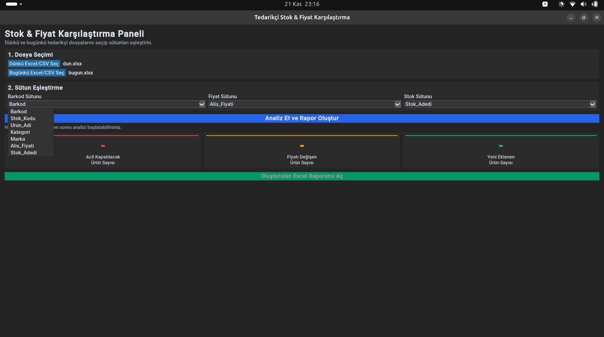
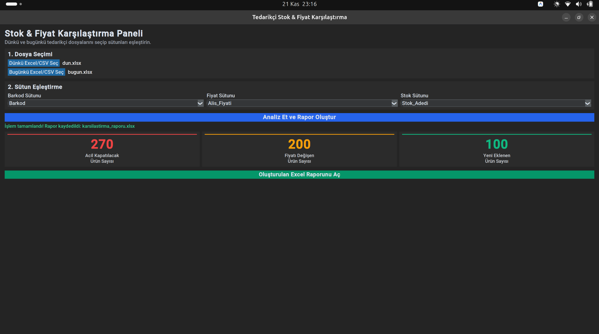
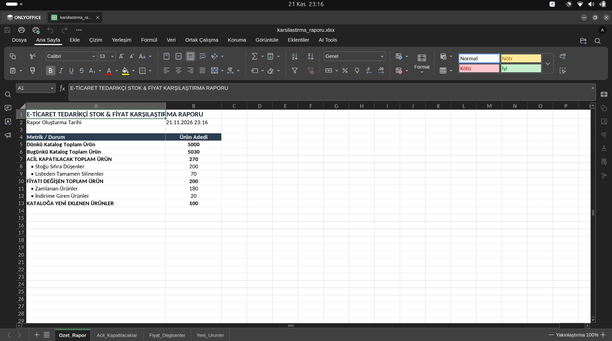
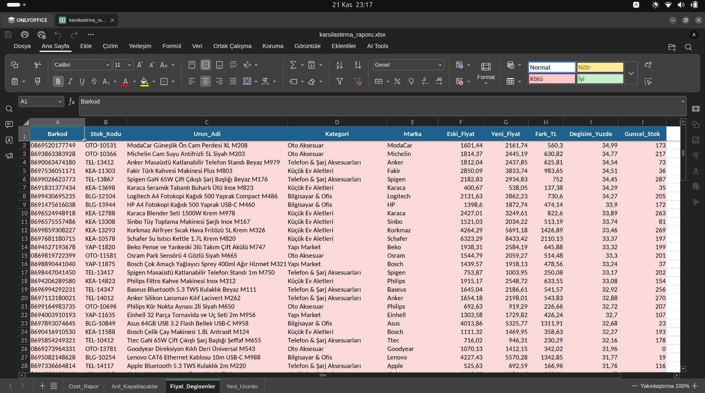
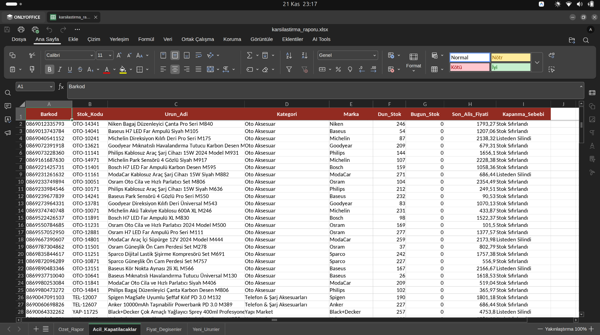
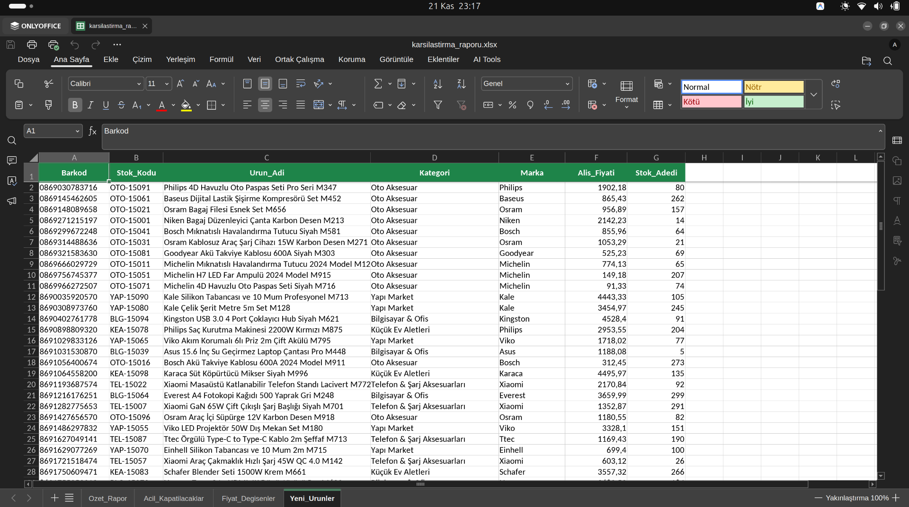

# E-Ticaret Tedarikçi Stok & Fiyat Karşılaştırma Paneli

E-ticaret satıcılarının (Trendyol, Hepsiburada, N11, Pazaryeri vb.) toptancı ve tedarikçilerden günlük olarak aldığı `.xlsx` ve `.csv` stok/fiyat listelerini saniyeler içinde kıyaslayan, **Python (Pandas, OpenPyXL, CustomTkinter)** tabanlı modüler masaüstü uygulamasıdır.

Binlerce satırlık tedarikçi listelerinde gözden kaçan stok bitişleri ve ani alış zammı kaynaklı zararları önlemek için geliştirilmiştir.

---

## Uygulama Ekran Görüntüleri

### 1. Dosya Seçimi ve Dinamik Sütun Eşleştirme


### 2. Analiz Sonuç Özeti


### 3. Üretilen Excel Raporu (Özet ve Fiyat Değişim Sekmeleri)



<details>
<summary><b>Diğer Excel Rapor Sekmelerini Görüntüle (Acil Kapatılacaklar & Yeni Ürünler)</b></summary>
<br>

**Acil Satışa Kapatılacaklar Sekmesi:**


**Yeni Eklenen Ürünler Sekmesi:**


</details>

---

## Öne Çıkan Özellikler

* **Kirli Veri ve Format Temizliği (`cleaner.py`):**
  * `0869...` ile başlayan barkodların başındaki sıfırları ve metin formatını bozmadan korur (bilimsel sayıya dönüşmesini engeller).
  * `"1.450,00 TL"` gibi Türkçe para birimi metinlerini otomatik olarak sayısal (`float`) değere çevirir.
  * Stok sütunundaki `"Tükendi"`, `"Yok"`, `"-"` veya boş hücreleri standart `0` değerine dönüştürür ve mükerrer barkodları tekilleştirir.
* **Akıllı Karşılaştırma Motoru (`comparator.py`):**
  * Dünkü ve bugünkü tedarikçi tablolarını `outer join` mantığıyla birleştirerek ürünleri 3 kritik kategoride ayrıştırır:
    * **Acil Satışa Kapatılacaklar:** Stoğu sıfıra düşen veya bugünkü tedarikçi listesinden satırı tamamen silinen ürünler.
    * **Fiyatı Değişenler:** Zamlanan ve indirime giren ürünlerin eski/yeni alış fiyatları, net TL farkı ve `%` değişim oranları.
    * **Yeni Eklenenler:** Dün katalogda olmayıp bugün tedarikçi listesine yeni giren ürünler.
* **Çok Sekmeli Kurumsal Excel Çıktısı (`exporter.py`):**
  * Yönetici özeti ve renk vurgulu detay sekmelerinden oluşan (`Ozet_Rapor`, `Acil_Kapatilacaklar`, `Fiyat_Degisenler`, `Yeni_Urunler`) doğrudan kullanıma hazır `.xlsx` raporu üretir.
  * Zamlanan satırları kırmızı, indirime giren satırları yeşil tonla vurgular; başlık satırlarını sabitler ve sütun genişliklerini otomatik ayarlar.
* **Dinamik Sütun Eşleştirme ve Donmayan Arayüz (`app.py`):**
  * Farklı tedarikçilerin farklı sütun isimlerine (`Barkod`, `EAN`, `Stok_Kodu`, `Alis_Fiyati` vb.) uyum sağlamak için dosya başlıklarını otomatik okur ve açılır menülerle eşleştirir.
  * Arka plan iş parçacığı (`threading`) sayesinde büyük dosyalarda arayüz donmadan çalışır.

---

## Proje Mimarisi

```text
├── app.py           # CustomTkinter masaüstü arayüzü ve arka plan iş yönetimi
├── cleaner.py       # Barkod, fiyat ve stok verisi temizleme katmanı
├── comparator.py    # Outer-merge kıyaslama ve istatistik motoru
├── exporter.py      # 4 sekmeli renkli Excel rapor üretici
├── requirements.txt # Gerekli Python kütüphaneleri
└── screenshots/     # Uygulama ve rapor ekran görüntüleri
```

---

## Kurulum ve Çalıştırma

```bash
git clone [https://github.com/ahmetbalkz250/Excel-ve-CSV-raporlama-app.git](https://github.com/ahmetbalkz250/Excel-ve-CSV-raporlama-app.git)
cd Excel-ve-CSV-raporlama-app
pip install -r requirements.txt
python app.py
```

---

## Lisans

Bu proje **MIT Lisansı** ile lisanslanmıştır.